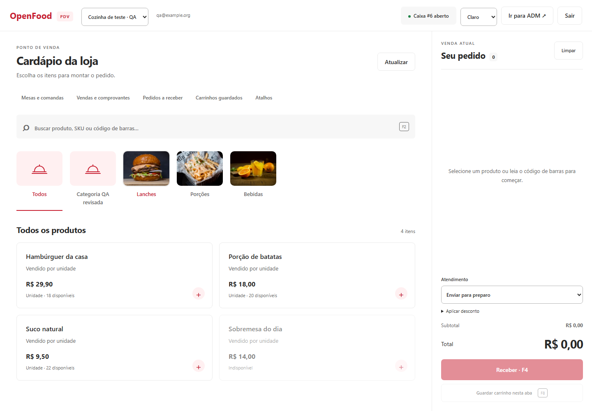
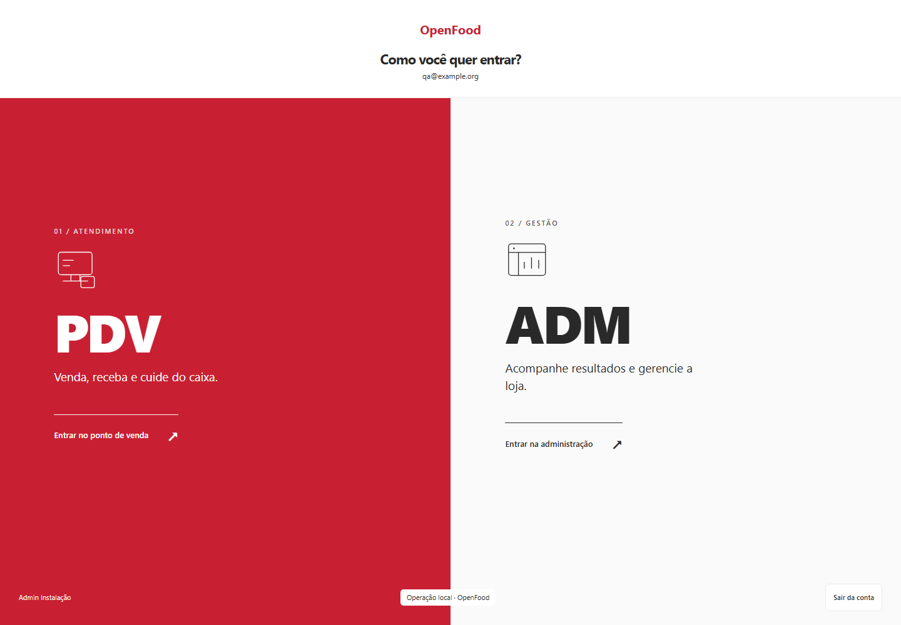
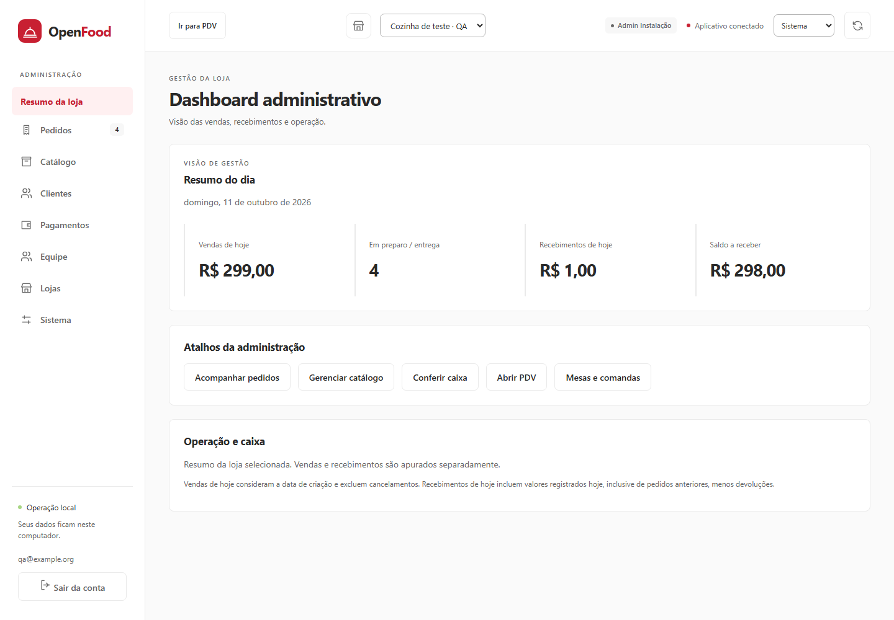
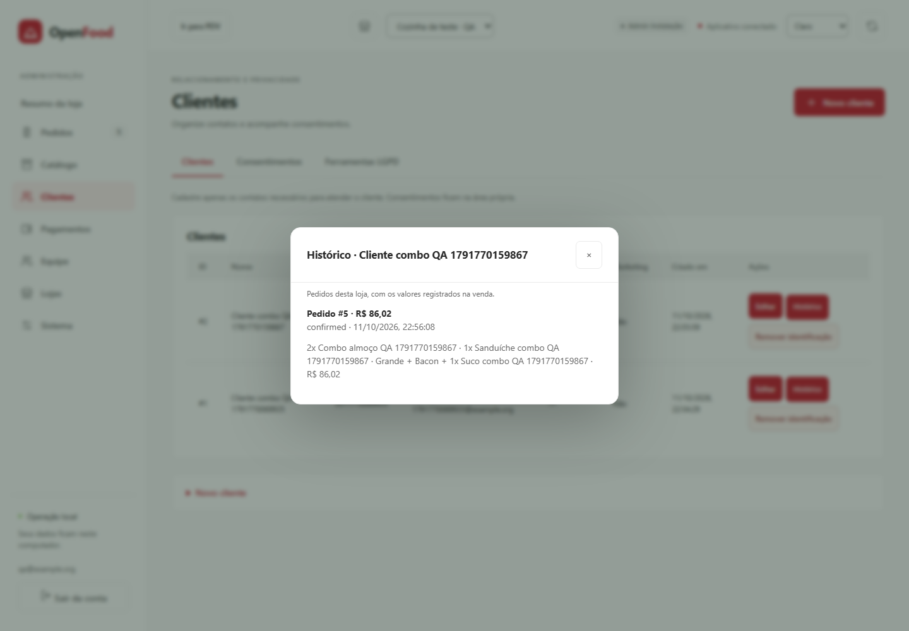
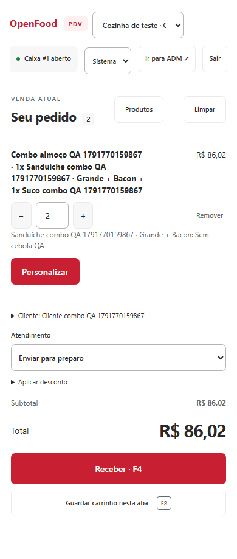
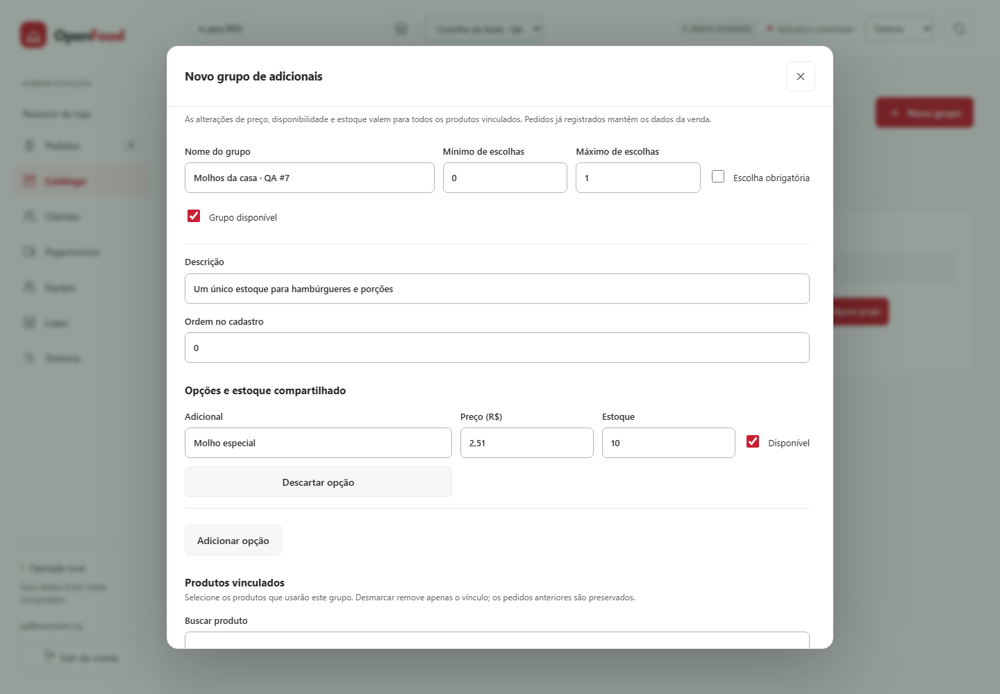

# OpenFood · PDV para restaurantes

**Do pedido ao fechamento do caixa, no seu próprio computador.**

OpenFood é um sistema de ponto de venda (PDV / POS) e gestão de restaurantes, livre e de operação local. Cardápio, mesas, comandas, cozinha e administração compartilham a mesma base, sem servidor central obrigatório.

[](https://github.com/gadevsbr/OpenFood/releases)
[](https://github.com/gadevsbr/OpenFood/actions/runs/38324219895)
[](LICENSE)

[**Baixar para Windows**](https://github.com/gadevsbr/OpenFood/releases/download/v0.13.0-alpha.1/OpenFood-0.13.0-alpha.1-windows-x64-setup.exe) · [Instalação Windows / Linux](docs/installation.md) · [Roadmap](project-memory/roadmap.md) · [English](README.en.md)



> **Alpha experimental · 0.13.0-alpha.1.** Há testes com PostgreSQL e navegador, além de CI Windows/Linux. Instalação em ambiente limpo, periféricos e operação fiscal ainda têm validações pendentes. As capturas são reais, com dados sintéticos de QA; as telas gerais mostram a direção visual introduzida na versão 0.9.

## Um espaço para atender. Outro para administrar.

Ao entrar, escolha **PDV | ADM**. O PDV concentra produtos, categorias e pedido; exige abertura do caixa antes da venda. Um botão no topo permite acessar o dashboard administrativo conforme as permissões do usuário.

| Escolha do modo | Dashboard administrativo |
| --- | --- |
|  |  |

## O que você pode fazer hoje

| Área | Recursos disponíveis |
| --- | --- |
| **Atendimento** | PDV, carrinhos em espera, mesas e comandas persistentes, rodadas de preparo e comprovantes não fiscais. |
| **Cardápio** | Categorias, fotos locais, tamanhos e variantes, adicionais com limites, observações por item e horários de disponibilidade. |
| **Pizzas** | Até quatro sabores, partes proporcionais e preço pelo maior valor ou média ponderada; ajuste de tamanho e adicionais. [Guia](docs/pizza.md). |
| **Combos** | Escolhas por grupo, preço fixo com ajustes, soma ou maior componente; composição registrada no pedido e estoque dos componentes. |
| **Caixa** | Abertura, sangria, suprimento, pagamentos manuais parciais/divididos, troco, desconto gerencial, devolução de recebimento e fechamento com diferença justificada. |
| **Cozinha** | Fila de preparo por etapa, com escolhas e observações dos itens. |
| **Clientes** | Identificação opcional no pedido, histórico por loja, consentimentos com texto/versionamento, exportação e remoção manual auditada de identificação. |
| **Administração** | Organizações, lojas, usuários e permissões por papel; catálogo e pedidos com isolamento por loja. |
| **Dados locais** | PostgreSQL, estoque transacional, preços registrados em centavos, proteção contra pedidos duplicados; backup/restauração pela interface no Windows e via Compose no Linux. |

<details>
<summary><strong>Ver o histórico do cliente e o pedido com combo no celular</strong></summary>





Capturas da etapa 0.11, com produtos e clientes de teste.

</details>

**Pagamentos são registros manuais:** dinheiro, cartão e Pix não acionam bancos, adquirentes ou reembolsos externos. Venda por peso, taxas, retenção automática e tratamento de remoções após restaurar backups antigos seguem no roadmap. Pix integrado, TEF, emissão fiscal, WhatsApp, iFood e IA não estão conectados. Os controles de privacidade existentes não constituem certificação de conformidade legal.

## Começar a usar

### Windows 10/11 · x64

1. Baixe o [instalador da versão 0.13](https://github.com/gadevsbr/OpenFood/releases/download/v0.13.0-alpha.1/OpenFood-0.13.0-alpha.1-windows-x64-setup.exe) e confira o [SHA256SUMS](https://github.com/gadevsbr/OpenFood/releases/download/v0.13.0-alpha.1/SHA256SUMS).
2. Instale e abra **OpenFood** pelo menu Iniciar. O PostgreSQL está incluído; o painel abre no navegador após a inicialização.
3. Crie sua loja, e-mail e senha com pelo menos 12 caracteres. Não há login ou senha padrão.
4. Cadastre seu cardápio pela **ADM**; entre no **PDV** e abra o caixa para vender.

A instalação é por usuário e não exige Go, Node ou Docker. Atualizações e desinstalação preservam os dados por padrão. Consulte o [guia de instalação, backup e atualização](docs/installation.md) antes de atualizar.

### Linux · Docker Compose

Com Docker Engine e Compose instalados:

```sh
git clone https://github.com/gadevsbr/OpenFood.git
cd OpenFood
cp .env.example .env
```

Preencha `POSTGRES_PASSWORD` e `SETUP_TOKEN` no `.env` com dois valores hexadecimais aleatórios de 32 bytes, diferentes entre si. Depois:

```sh
docker compose up --build -d
curl http://127.0.0.1:18880/readyz
```

Abra **http://127.0.0.1:18880** e informe o token no setup. O volume `database` mantém os dados. Veja [backup e operação Linux](docs/installation.md#linux).

O modo suportado atualmente é local, em loopback. O computador precisa permanecer ligado para operar. Fontes, ícones e scripts da interface são locais, embutidos no executável; não há telemetria obrigatória.

## Guias e desenvolvimento

| Precisa de… | Consulte |
| --- | --- |
| Vender e receber | [PDV](docs/pos.md) · [Caixa](docs/cash.md) |
| Organizar o atendimento | [Mesas e comandas](docs/dining.md) |
| Montar seu cardápio | [Variantes e adicionais](docs/menu.md) · [Combos e clientes](docs/combos-customers.md) · [Pizzas](docs/pizza.md) · [Adicionais compartilhados](docs/addons.md) |
| Instalar, atualizar ou recuperar dados | [Instalação e operação](docs/installation.md) |
| Entender as próximas entregas | [Roadmap](project-memory/roadmap.md) · [Estado e limites](project-memory/status.md) |
| Contribuir ou executar os testes | [Contribuição](CONTRIBUTING.md) · [Desenvolvimento e QA](docs/development.md) |
| Reportar problemas de segurança | [Política de segurança](SECURITY.md) |

**Stack:** Go 1.27.2, PostgreSQL 17, interface web embutida e Motion mini com respeito a `prefers-reduced-motion`. Node é usado para construir animações e executar QA, não pelo usuário final.

A [release 0.13](https://github.com/gadevsbr/OpenFood/releases/tag/v0.13.0-alpha.1) inclui instalador, pacotes Windows/Linux, capturas de QA e manifests SHA-256. [CI da versão](https://github.com/gadevsbr/OpenFood/actions/runs/38324219895) e [registro de validação](project-memory/addons-stage.md) documentam o que foi testado e os gates abertos.

Encontrou um problema? [Abra uma issue](https://github.com/gadevsbr/OpenFood/issues/new/choose) com a versão e os passos para reproduzir, usando dados de teste. Sugestões e contribuições são bem-vindas.

## Adicionais compartilhados

Um cadastro de molhos, bordas ou acompanhamentos para vários produtos, com preço e estoque comuns e confirmação dos produtos afetados. [Guia](docs/addons.md).




## Licença

[AGPL-3.0-only](LICENSE). O software não exige assinatura comercial; provedores externos opcionais têm seus próprios custos.
